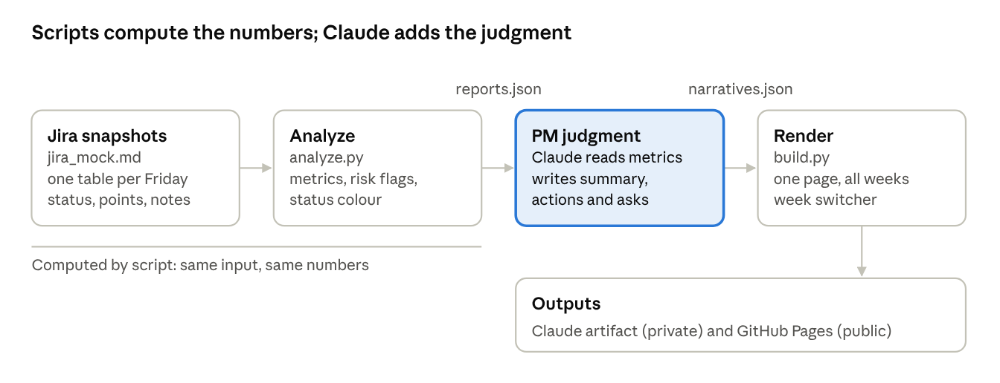

# PM Sprint Status Agent: Approach

Oct 25, 2026

## Overview

The PM Sprint Status Agent turns weekly Jira snapshots into a finished sprint status report: a red, amber or green status, sprint health, risk flags with recommended actions, and named asks with dates.

Weekly status reporting is mostly assembly work. A PM pulls the board, counts points, works out what is blocked and for how long, compares with last week, then writes the same kind of summary again. The numbers are mechanical; the judgment is the valuable part. This project automates the first and focuses Claude on the second.

The outcome is a working prototype on six weeks of synthetic data. It correctly tracks the project from amber to red and, for the latest week (Oct 23, 2026), recommends a release scope decision: ship Nov 6 without identity verification, or move GA to Nov 20.

## How it works

Each weekly run has four steps, and only one of them uses Claude.

Splitting the work this way keeps the figures repeatable: run the analysis twice on the same file and the numbers match. Claude never calculates; it interprets. That makes the report checkable and puts Claude's effort into the part a PM actually adds: what matters, what to do, and who decides.

## Synthetic data design

The agent is tested on `jira_mock.md`: a fictional project, Atlas - Mobile Onboarding v2, with 23 issues, a team of six plus a PM, and three 2-week sprints (Sprints 40 to 42) ahead of a Nov 6 release. It is generated by `gen_jira_mock.py`, so the scenario can be changed and regenerated.

The file holds one table per weekly snapshot, taken every Friday from Sep 18 to Oct 23, 2026: a mid-sprint and a sprint-close view of each sprint. Each snapshot shows the active sprint board with these columns: Key, Summary, Type, Priority, Status, Status since, Assignee, Pts, Sprints, Added, Created, Due, Notes.

Three columns do most of the work. *Status since* gives days in status (days blocked, days in review). *Sprints* lists every sprint an issue has been in, which exposes carry-overs. *Added* marks mid-sprint scope changes.

The data contains deliberate storylines, so each kind of risk the agent should catch is present at least once:

| Storyline | Issue | What the agent should catch |
| --- | --- | --- |
| Vendor contract stuck in Legal | ATL-108 KYC integration | Blocked 23 days, carried over, overdue |
| Legal approval of consent copy | ATL-119 consent screen | Blocked 10 days, same dependency as ATL-108 |
| Code review with no reviewer | ATL-112 push opt-in | In review 15 days |
| Work nobody starts | ATL-115 E2E test suite | To Do for 25 days, QA at 50% |
| Blocker that clears | ATL-101 social sign-in, ATL-118 localisation | Blocked, then resolved and done |
| Production incident | ATL-120 bug | Added mid-sprint, fixed in 3 days |
| Scope creep | ATL-120 to ATL-123 | +9 pts added during Sprint 42 |
| Over-commitment | Sprints 41 and 42 | 50 and 42 pts committed against 18 to 23 pts of velocity |

Delivery falls from 27 points in Sprint 41 to 10 in Sprint 42, so the report should move from amber to red.

## Analysis rules

`analyze.py` computes every figure in the report from the snapshots, with no judgment involved. Each week gets:

- **Sprint health:** done points vs current scope, % done vs % of working days elapsed, points committed at planning, points added mid-sprint, open items.
- **Velocity:** points done at each sprint close, and the average of earlier closed sprints.
- **Week-over-week:** blockers new and resolved since the last snapshot, change in blocked and carried-over counts, items completed this week.
- **Per-person load:** open points and blocked points per assignee.
- **Timelines:** status at each snapshot for every stuck or carried-over issue.

Risk flags are merged per issue, so one issue with several problems shows as one row:

| Flag | Trigger | Severity |
| --- | --- | --- |
| Blocker | Status is Blocked | HIGH if 7+ days or Highest priority, else MEDIUM |
| Review stall | In Review 5+ days | HIGH if 10+ days, else MEDIUM |
| Not started | To Do 7+ days | HIGH if carried over and High or Highest priority, else MEDIUM |
| Carry-over | In more than one sprint | HIGH in its 3rd sprint, else MEDIUM |
| Overdue | Past its due date and not done | MEDIUM |
| Over-commitment | Commitment over 1.2× average velocity | HIGH over 1.6×, else MEDIUM |
| Scope creep | Any mid-sprint adds | HIGH at 20%+ of commitment, else MEDIUM |
| Burndown | % done trails % elapsed by 20+ points | HIGH at 40+ points, else MEDIUM |
| Load | One person holds 13+ open pts, or 60%+ of their open pts are blocked | MEDIUM |

The overall status follows fixed rules:

- **At sprint close:** RED if under 50% of scope is done; AMBER if under 80% or anything is blocked; otherwise GREEN.
- **Mid-sprint:** RED if a blocker is 7+ days old and % done trails % elapsed by 30+ points; AMBER if anything is blocked, the gap is 15+ points, or 2+ items carried over; otherwise GREEN.

On the mock data this gives amber for the first four weeks and red for the last two (Oct 16 and Oct 23).

## PM judgment layer

For each week, Claude reads the computed metrics and the issue notes, then writes four things into `narratives.json`:

| Field | What it holds | Example (week of Oct 23) |
| --- | --- | --- |
| Headline | The verdict in one sentence | Sprint 42 closed at 20%; the Nov 6 release needs a scope decision this week |
| Summary | 3 to 5 bullets: delivery vs plan, top risk with its cause, change since last week, good news | Both release gates wait on the same Legal review |
| Actions | A recommended action per risk, keyed by issue or flag type | Get a Legal decision by Oct 28, or ship KYC behind a flag later |
| Asks | Named owner, the decision needed, and a date | Product to choose by Oct 29: ship without KYC or move GA to Nov 20 |

The writing follows a few rules:

- Every number must come from the computed metrics, never estimated.
- Read the Notes column: it holds why an item is stuck, which the numbers alone don't show.
- Recommend a decision, not just escalation. "Escalate to Legal" is weaker than "decide by Wednesday or descope".
- Name an owner and a date for every ask.
- Leave past weeks' narratives unchanged unless asked.

Where Claude has not written an action for a flag, the report uses a default action for that flag type, so no risk ever appears without a next step.

## Outputs and delivery

The report is one page holding all six weeks, with a strip at the top to switch weeks; each week shows its status colour on the strip. Each report has eight sections: executive summary, sprint health, risk flags, blockers, stuck or carried-over items, completed this week, trends (velocity and blockers over time), and asks.

| Output | Where | Notes |
| --- | --- | --- |
| Report artifact | [Atlas Weekly Status](https://claude.ai/artifact/DVZVJR6ntfwbgDXZES6Yik) | Private Claude artifact, updated in place each week |
| Code repository | [github.com/mpahade/PMAgent](https://github.com/mpahade/PMAgent) | Data, scripts, built report, README |
| Public report page | [mpahade.github.io/PMAgent](https://mpahade.github.io/PMAgent/) | `index.html`, a standalone build of the report; live once GitHub Pages is switched on in the repo settings |
| Walkthrough video | `pm_agent_video.mp4` in the repo | 45 seconds with on-screen captions; spoken voiceover not added yet |
| Voiceover script | `voiceover_script.md` in the repo | About 115 words, timed per scene |
| Reusable skill | pm-sprint-status-agent | Lets Claude repeat the weekly run; offered in chat to save |
| Project files | Week3 project, `claude/pm_agent/` | Scripts and narratives the skill reads |

`build.py` produces two builds from the same template: one for the Claude artifact viewer, and a standalone page (`--standalone`) for GitHub Pages or any browser.

## Key decisions and trade-offs

The biggest decision was replacing the first build, an n8n workflow, with plain files and scripts. The n8n version had a Friday 3pm schedule, a Jira node, snapshot and report data tables, and an agent with lookup tools. It stalled when the n8n Cloud trial expired and executions were blocked; it also still needed an Anthropic credential and a published workflow before the agent could be validated.

| Decision | Chosen | Alternative | Why |
| --- | --- | --- | --- |
| Platform | Markdown file + Python scripts + Claude skill | n8n workflow with data tables | Runs anywhere with no subscription; easy to read, version and share on GitHub |
| Data source | Synthetic weekly snapshots | Live Jira | Safe to share publicly; storylines guarantee every risk type appears |
| Data shape | Weekly snapshots of the board | Issue change history | Week-over-week comparison falls out directly; matches how PMs report |
| Numbers vs judgment | Script computes, Claude writes | Claude does both | Figures are repeatable and checkable; Claude's effort goes to recommendations |
| Report format | One page with a week switcher | One document per week | History and trends sit next to the current week |
| Dependencies | Python standard library only | pandas, charting libraries | Nothing to install; charts are drawn in the page itself |

The main trade-off is automation. The n8n design would have run by itself every Friday; this version runs when asked, or on a schedule once one is set up.

## Limitations and next steps

The agent works end to end on mock data, but four gaps remain before it can run on a real team:

- **No live Jira connection.** Snapshots must be exported into the markdown format by hand. A Jira connector or API export that writes the same table would remove that step.
- **Thresholds are untested.** The risk and status thresholds (7 days blocked, 1.2× velocity) were chosen for the demo and should be tuned with a real team's history.
- **Runs on request only.** A Friday scheduled task could run the skill each week and update the report.
- **Narratives are written per week.** Six weeks were backfilled by hand; on a live team only the newest week is written each Friday.

Open items for this project:

- [ ] Turn on GitHub Pages in the repo settings (Source: main, root)
- [ ] Add a spoken voiceover to the walkthrough video
- [ ] Save the pm-sprint-status-agent skill
- [ ] Decide whether to set up the weekly scheduled run

## Links and files

| File | Purpose |
| --- | --- |
| [GitHub repository](https://github.com/mpahade/PMAgent) | All code, data and outputs |
| [Report artifact](https://claude.ai/artifact/DVZVJR6ntfwbgDXZES6Yik) | Weekly status reports, Sep 18 to Oct 23 |
| `jira_mock.md` | Synthetic Jira snapshots |
| `gen_jira_mock.py` | Generates the mock data |
| `pm_agent/analyze.py` | Computes metrics, flags and status |
| `pm_agent/narratives.json` | Claude's weekly headline, summary, actions and asks |
| `pm_agent/template.html` | Report page template |
| `pm_agent/build.py` | Builds the report page |
| `README.md` | How to run it |
